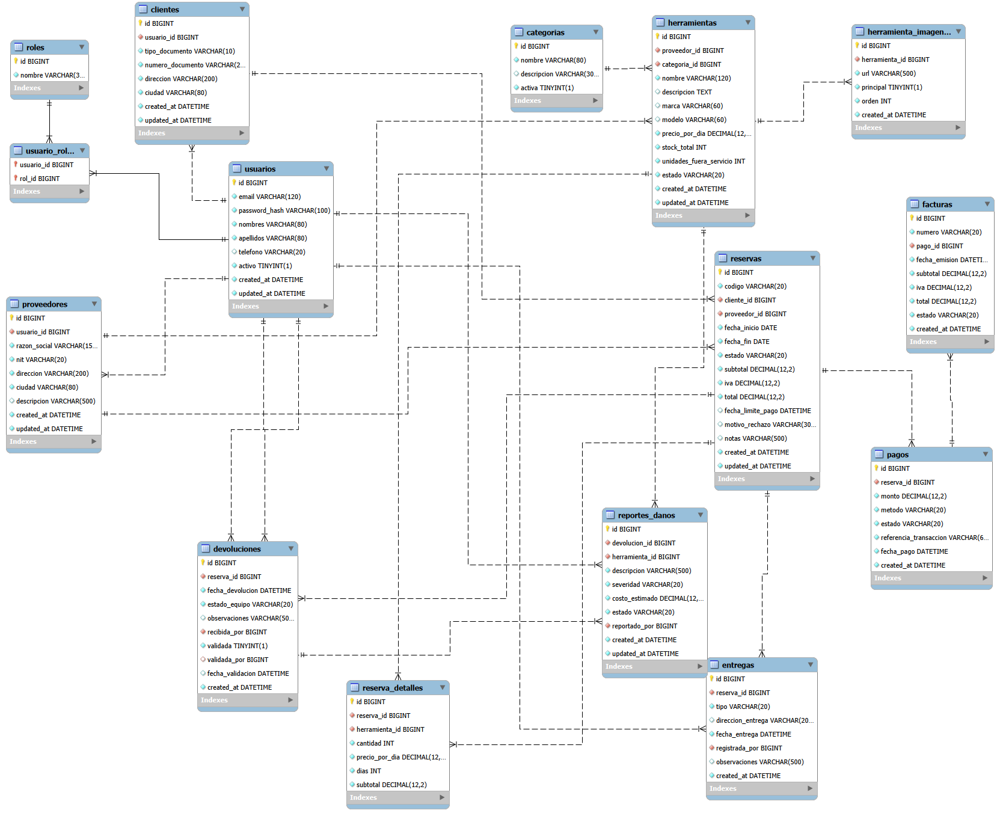

# 🛠️ Plataforma de Renta de Herramientas y Equipos de Construcción

API REST construida con **Spring Boot** para que proveedores publiquen su inventario de herramientas y equipos de construcción, y que los clientes puedan reservarlos, pagarlos y descargar su factura. Incluye panel por rol (Administrador, Proveedor, Cliente), control de disponibilidad, gestión de devoluciones y daños, y reportes de rentabilidad.

> Proyecto principal del skill de Spring Boot — Campuslands.
> Autor: **Sebastián Acelas**

---

## 📑 Tabla de contenidos

1. [Tecnologías](#-tecnologías)
2. [Arquitectura](#-arquitectura)
3. [Estructura del proyecto](#-estructura-del-proyecto)
4. [Requisitos previos](#-requisitos-previos)
5. [Instalación y ejecución](#-instalación-y-ejecución)
6. [Configuración (`application.yml`)](#-configuración)
7. [Base de datos](#-base-de-datos)
8. [Autenticación y roles](#-autenticación-y-roles)
9. [Endpoints de la API](#-endpoints-de-la-api)
10. [Flujo de trabajo con Git Flow](#-flujo-de-trabajo-con-git-flow)
11. [Estado del proyecto](#-estado-del-proyecto)

---

## 🧰 Tecnologías

| Capa | Tecnología | Versión |
|---|---|---|
| Lenguaje | Java | 21 |
| Framework | Spring Boot | 4.1.1 |
| Servidor | Apache Tomcat (embebido) | incluido en Spring Boot |
| Persistencia | Spring Data JPA + Hibernate | gestionado por Spring Boot |
| Base de datos | MySQL | 8.x |
| Migraciones | Flyway | gestionado por Spring Boot |
| Seguridad | Spring Security + JWT (jjwt) | 7.x / 0.13.0 |
| Documentación API | springdoc-openapi (Swagger UI) | 3.1.0 |
| Facturas PDF | OpenPDF | 2.0.3 |
| Pruebas | JUnit 5, AssertJ, Mockito | gestionado por Spring Boot |
| Build | Maven (multimódulo) | 3.9+ |

---

## 🏛️ Arquitectura

El proyecto aplica **Arquitectura Hexagonal (Puertos y Adaptadores)** con **Domain-Driven Design**, dividido en tres módulos Maven. La regla central es que **las dependencias apuntan hacia adentro**: la infraestructura conoce al dominio, pero el dominio no conoce a nadie.

```
infrastructure  ──►  application  ──►  domain
 (Spring, JPA,        (casos de uso,      (reglas de negocio,
  REST, MySQL)         puertos)            Java puro)
```

### Equivalencia con la arquitectura por capas

El enunciado pide separación en Controllers, Services, Repositories, DTOs y Entities. En hexagonal esas capas existen, con un rol más preciso:

| Capa clásica | Dónde vive en este proyecto | Módulo |
|---|---|---|
| Controllers | `adapters/inbound/controller` | infrastructure |
| Services | `application/usecases` (implementan los puertos de entrada) | application |
| Repositories | Interfaz en `domain/repositories`, implementación JPA en `adapters/outbound/persistence/repositories` | domain + infrastructure |
| DTOs | HTTP en `adapters/inbound/dtos`, de aplicación en `application/dtos` | infrastructure + application |
| Entities | Modelo de negocio en `domain/model`, tablas en `adapters/outbound/persistence/entities` | domain + infrastructure |

**¿Por qué separar el modelo de dominio de las entidades JPA?** Porque así las reglas del negocio (por ejemplo, "no se puede reservar una herramienta sin unidades disponibles") se prueban sin base de datos, y cambiar MySQL por otro motor no toca el dominio.

---

## 🗂️ Estructura del proyecto

```
Proyecto_RentaHerramientas_AcelasSebastian
├── pom.xml                         # Proyecto padre (packaging pom)
├── database/                       # Script de creación de BD y usuario
├── docs/                           # Diagrama relacional
├── domain/                         # Núcleo del negocio (Java puro)
│   └── src/main/java/com/rentaherramientas/domain
│       ├── model
│       │   ├── aggregates
│       │   └── valueobject
│       ├── repositories            # Puertos de persistencia
│       ├── exceptions
│       └── events
├── application/                    # Casos de uso (Java puro)
│   └── src/main/java/com/rentaherramientas/application
│       ├── config
│       ├── dtos
│       ├── exceptions
│       ├── mappers
│       ├── ports                   # in: casos de uso / out: pagos, archivos...
│       └── usecases
└── infrastructure/                 # Spring Boot: adaptadores y arranque
    └── src/main/java/com/rentaherramientas/infrastructure
        ├── RentaHerramientasApplication.java
        ├── config                  # Wiring de casos de uso, Swagger
        ├── security                # JWT, filtros, CORS, BCrypt
        └── adapters
            ├── inbound
            │   ├── controller
            │   ├── exceptionhandler
            │   ├── dtos
            │   └── scheduler       # Tareas programadas (vencimiento de reservas)
            └── outbound
                ├── persistence
                │   ├── entities
                │   ├── mappers
                │   └── repositories
                ├── storage         # Almacenamiento de imágenes
                ├── pagos           # Pasarela de pagos (simulada)
                └── pdf             # Generación de facturas en PDF
```

---

## ✅ Requisitos previos

- JDK 21 (`java -version`)
- Maven 3.9 o superior (`mvn -v`)
- MySQL 8 en ejecución
- Git

---

## 🚀 Instalación y ejecución

### 1. Clonar el repositorio

```bash
git clone https://github.com/sebastianace/Proyecto_RentaHerramientas_AcelasSebastian.git
cd Proyecto_RentaHerramientas_AcelasSebastian
```

### 2. Crear la base de datos y el usuario

Abre `database/00_create_database_and_user.sql`, cambia la clave `cambia_esta_clave` por una tuya y ejecútalo con el usuario `root` (MySQL Workbench o consola):

```bash
mysql -u root -p < database/00_create_database_and_user.sql
```

Las tablas **no** se crean a mano: Flyway las crea automáticamente al arrancar la aplicación.

### 3. Configurar las variables de entorno

Copia la plantilla y escribe tus valores reales:

```bash
# Windows (PowerShell)
Copy-Item .env.example .env
# Linux / macOS
cp .env.example .env
```

Genera tu propia clave para firmar los JWT (48 bytes aleatorios en Base64) y pégala en `JWT_SECRET`:

```powershell
# Windows (PowerShell)
$b = New-Object byte[] 48; [Security.Cryptography.RandomNumberGenerator]::Create().GetBytes($b); [Convert]::ToBase64String($b)
```

```bash
# Linux / macOS
openssl rand -base64 48
```

### 4. Compilar e instalar los módulos

```bash
mvn clean install
```

### 5. Ejecutar

```bash
mvn -pl infrastructure spring-boot:run
```

La API queda disponible en `http://localhost:8080` y la documentación interactiva en **`http://localhost:8080/swagger-ui.html`**.

---

## ⚙️ Configuración

La configuración está en `infrastructure/src/main/resources` y se divide por perfiles:

| Archivo | Uso |
|---|---|
| `application.yml` | Configuración común: datasource, JPA, Flyway, Tomcat, carga de archivos |
| `application-dev.yml` | Desarrollo: SQL visible en consola, logs en DEBUG, carga datos de prueba |
| `application-prod.yml` | Producción: sin SQL en consola, `DB_URL` obligatoria |

Ejemplo (fragmento de `application.yml`):

```yaml
spring:
  profiles:
    active: ${SPRING_PROFILES_ACTIVE:dev}
  datasource:
    username: ${DB_USERNAME}
    password: ${DB_PASSWORD}
  jpa:
    open-in-view: false
    hibernate:
      ddl-auto: validate   # Flyway maneja el esquema
  flyway:
    locations: classpath:db/migration
```

| Variable | Descripción | Ejemplo |
|---|---|---|
| `SPRING_PROFILES_ACTIVE` | Perfil activo | `dev` |
| `DB_URL` | URL JDBC de MySQL | `jdbc:mysql://localhost:3306/renta_herramientas` |
| `DB_USERNAME` | Usuario de la BD | `renta_app` |
| `DB_PASSWORD` | Clave de la BD | — |
| `MEDIA_BASE_PATH` | Carpeta para imágenes | `./uploads` |
| `JWT_SECRET` | Clave Base64 (mínimo 32 bytes) para firmar los tokens | — |
| `JWT_EXPIRACION` | Vida del token | `60m` |
| `CORS_ALLOWED_ORIGINS` | Orígenes del frontend permitidos | `http://localhost:5500` |

---

## 🗄️ Base de datos

### Diagrama relacional



El modelo tiene **15 tablas** organizadas por contexto de negocio:

| Contexto | Tablas |
|---|---|
| Identidad | `roles`, `usuarios`, `usuario_roles`, `proveedores`, `clientes` |
| Catálogo | `categorias`, `herramientas`, `herramienta_imagenes` |
| Alquileres | `reservas`, `reserva_detalles`, `entregas`, `devoluciones`, `reportes_danos` |
| Facturación | `pagos`, `facturas` |

**Reglas de diseño principales**

- Una reserva pertenece a **un solo proveedor**, que es quien la aprueba o rechaza.
- El precio por día se **congela** en `reserva_detalles` al reservar; los cambios de precio posteriores no afectan reservas ni facturas existentes.
- **Disponibilidad** de una herramienta en un rango de fechas = `stock_total` − `unidades_fuera_servicio` − unidades en reservas `APROBADA`, `PAGADA` o `ENTREGADA` que se cruzan con ese rango.
- Días cobrados = `fecha_fin − fecha_inicio + 1` (ambos días incluidos). IVA del 19 %.
- Los montos usan `DECIMAL(12,2)`; los estados son `VARCHAR` con restricción `CHECK`.
- Usuarios y herramientas con historial no se eliminan físicamente: se desactivan (borrado lógico).

**Ciclo de vida de una reserva**

```
PENDIENTE ──► APROBADA ──► PAGADA ──► ENTREGADA ──► DEVUELTA
    │             │
    ├► RECHAZADA  ├► VENCIDA (no se pagó antes de fecha_limite_pago)
    └► CANCELADA  └► CANCELADA
```

### Scripts SQL

El esquema y los datos se crean con **Flyway** al arrancar la aplicación. Los scripts están en `infrastructure/src/main/resources/db/`:

| Script | Contenido |
|---|---|
| `migration/V1__create_identity_tables.sql` | Usuarios, roles, proveedores y clientes |
| `migration/V2__create_catalog_tables.sql` | Categorías, herramientas e imágenes |
| `migration/V3__create_rental_tables.sql` | Reservas, detalles, entregas, devoluciones y daños |
| `migration/V4__create_billing_tables.sql` | Pagos y facturas |
| `migration/V5__add_query_indexes.sql` | Índices para búsquedas y reportes |
| `seed/V6__seed_identity.sql` | 42 usuarios (2 admin, 20 proveedores, 20 clientes) |
| `seed/V7__seed_catalog.sql` | 20 categorías, 40 herramientas y sus imágenes |
| `seed/V8__seed_rentals.sql` | 35 reservas en todos los estados, entregas, devoluciones y daños |
| `seed/V9__seed_billing.sql` | 30 pagos (aprobados y rechazados) y 27 facturas |

Los datos de prueba (`db/seed`) **solo se cargan en el perfil `dev`**. En `prod` Flyway aplica únicamente `db/migration`.

Para crear la base sin la aplicación, ejecuta los scripts en orden (V1 → V9) sobre la base `renta_herramientas`.

> La tabla `roles` es un catálogo fijo de 3 registros (ADMIN, PROVEEDOR, CLIENTE). Todas las demás tablas tienen al menos 20 registros.

### Usuarios de prueba

Todos usan la clave **`Renta2026*`** (almacenada como hash BCrypt).

| Rol | Email |
|---|---|
| ADMIN | `admin@rentaherramientas.com` |
| PROVEEDOR | `carlos.rueda@herroriente.com` |
| CLIENTE | `juanpablo.ardila@gmail.com` |

---

## 🔐 Autenticación y roles

La API es **stateless**: no guarda sesiones. Cada petición protegida debe enviar un **JWT** en el header:

```
Authorization: Bearer <token>
```

### Flujo

```
1. POST /api/v1/auth/login  {email, password}
2. Spring Security verifica la clave con BCrypt (AuthenticationManager + UserDetailsService)
3. La API responde {token, tipo: "Bearer", expiraEn, usuario}
4. El cliente envía el token en cada petición
5. JwtValidationFilter valida firma, emisor y expiración → registra al usuario en el SecurityContext
6. @PreAuthorize decide si su rol puede usar el endpoint
```

El token está firmado con **HMAC-SHA** usando `JWT_SECRET`. Su contenido (*payload*) lleva el email (`sub`), el id del usuario (`uid`), sus `roles`, el emisor (`iss`) y la expiración (`exp`). Si alguien modifica el payload, la firma deja de coincidir y el token se rechaza.

### Roles

| Rol | Cómo se crea | Qué puede hacer |
|---|---|---|
| `ADMIN` | Datos iniciales | Gestiona clientes y proveedores, supervisa alquileres, pagos y reportes |
| `PROVEEDOR` | Lo registra el ADMIN | Gestiona su inventario, sus reservas y su facturación |
| `CLIENTE` | Registro público (`/auth/registro`) o el ADMIN | Explora herramientas, reserva, paga y consulta su historial |

Además del rol, los casos de uso validan la **propiedad del recurso**: un cliente solo puede ver y editar su propio perfil, aunque conozca el id de otro.

### Respuestas de error

Todos los errores siguen el estándar **ProblemDetail (RFC 9457)**:

```json
{
  "type": "about:blank",
  "title": "Conflicto",
  "status": 409,
  "detail": "Ya existe un usuario registrado con el email laura.perez@gmail.com",
  "instance": "/api/v1/auth/registro",
  "timestamp": "2026-10-14T16:00:00Z"
}
```

| Código | Cuándo |
|---|---|
| 400 | Datos inválidos (incluye el detalle de cada campo en `errores`) |
| 401 | Sin token, token vencido o credenciales incorrectas |
| 403 | Rol insuficiente, recurso de otro usuario o usuario inactivo |
| 404 | El recurso no existe |
| 409 | Dato duplicado (email, documento, NIT) |
| 422 | Regla de negocio incumplida |

---

## 📡 Endpoints de la API

La documentación completa, con ejemplos y la opción de probar cada endpoint, está en **Swagger UI**: `http://localhost:8080/swagger-ui.html`.

### Autenticación

| Método | Ruta | Acceso | Descripción |
|---|---|---|---|
| POST | `/api/v1/auth/login` | Público | Iniciar sesión |
| POST | `/api/v1/auth/registro` | Público | Registrarse como cliente |
| GET | `/api/v1/auth/me` | Autenticado | Perfil del usuario autenticado |

Ejemplo de login:

```json
POST /api/v1/auth/login
{
  "email": "admin@rentaherramientas.com",
  "password": "Renta2026*"
}
```

```json
200 OK
{
  "token": "eyJhbGciOiJIUzM4NCJ9...",
  "tipo": "Bearer",
  "expiraEn": "2026-10-14T17:00:00Z",
  "usuario": {
    "id": 1,
    "email": "admin@rentaherramientas.com",
    "nombres": "Administrador",
    "apellidos": "Principal",
    "telefono": "3001112233",
    "activo": true,
    "roles": ["ADMIN"]
  }
}
```

### Clientes

| Método | Ruta | Acceso | Descripción |
|---|---|---|---|
| GET | `/api/v1/clientes?pagina=0&tamanio=20` | ADMIN | Listar clientes |
| GET | `/api/v1/clientes/{id}` | ADMIN, CLIENTE (propio) | Obtener un cliente |
| POST | `/api/v1/clientes` | ADMIN | Registrar un cliente |
| PUT | `/api/v1/clientes/{id}` | ADMIN, CLIENTE (propio) | Actualizar un cliente |
| DELETE | `/api/v1/clientes/{id}` | ADMIN | Desactivar (borrado lógico) |
| PATCH | `/api/v1/clientes/{id}/activar` | ADMIN | Reactivar |

### Proveedores

| Método | Ruta | Acceso | Descripción |
|---|---|---|---|
| GET | `/api/v1/proveedores?pagina=0&tamanio=20` | ADMIN | Listar proveedores |
| GET | `/api/v1/proveedores/{id}` | ADMIN, PROVEEDOR (propio) | Obtener un proveedor |
| POST | `/api/v1/proveedores` | ADMIN | Registrar un proveedor |
| PUT | `/api/v1/proveedores/{id}` | ADMIN, PROVEEDOR (propio) | Actualizar un proveedor |
| DELETE | `/api/v1/proveedores/{id}` | ADMIN | Desactivar (borrado lógico) |
| PATCH | `/api/v1/proveedores/{id}/activar` | ADMIN | Reactivar |


### Categorías

| Método | Ruta | Acceso | Descripción |
|---|---|---|---|
| GET | `/api/v1/categorias` | Público | Listar categorías activas (`?incluirInactivas=true` solo ADMIN) |
| GET | `/api/v1/categorias/{id}` | Público | Obtener una categoría |
| POST | `/api/v1/categorias` | ADMIN | Crear |
| PUT | `/api/v1/categorias/{id}` | ADMIN | Actualizar |
| DELETE | `/api/v1/categorias/{id}` | ADMIN | Desactivar |
| PATCH | `/api/v1/categorias/{id}/activar` | ADMIN | Reactivar |

### Herramientas

| Método | Ruta | Acceso | Descripción |
|---|---|---|---|
| GET | `/api/v1/herramientas` | Público | Catálogo: herramientas activas, con filtros opcionales `categoriaId`, `texto`, `ciudad`, `precioMaximo` |
| GET | `/api/v1/herramientas/{id}` | Público | Detalle con imágenes |
| GET | `/api/v1/herramientas/inventario` | PROVEEDOR, ADMIN | Inventario en cualquier estado (`?estado=`, ADMIN también `?proveedorId=`) |
| POST | `/api/v1/herramientas` | PROVEEDOR, ADMIN | Agregar herramienta |
| PUT | `/api/v1/herramientas/{id}` | Dueño, ADMIN | Actualizar precio, stock y unidades fuera de servicio |
| PATCH | `/api/v1/herramientas/{id}/estado` | Dueño, ADMIN | `ACTIVA`, `EN_MANTENIMIENTO` o `INACTIVA` |
| DELETE | `/api/v1/herramientas/{id}` | Dueño, ADMIN | Retirar (borrado lógico) |
| POST | `/api/v1/herramientas/{id}/imagenes` | Dueño, ADMIN | Subir imagen (`multipart/form-data`, campo `archivo`) |
| PATCH | `/api/v1/herramientas/{id}/imagenes/{imagenId}/principal` | Dueño, ADMIN | Marcar imagen principal |
| DELETE | `/api/v1/herramientas/{id}/imagenes/{imagenId}` | Dueño, ADMIN | Eliminar imagen |

Ejemplo de búsqueda en el catálogo:

```
GET /api/v1/herramientas?categoriaId=1&ciudad=Bucaramanga&precioMaximo=50000&pagina=0&tamanio=12
```

```json
{
  "contenido": [
    {
      "id": 1,
      "nombre": "Rotomartillo SDS Plus 800W",
      "marca": "Bosch",
      "precioPorDia": 35000.00,
      "stockTotal": 6,
      "unidadesFueraServicio": 0,
      "unidadesOperativas": 6,
      "estado": "ACTIVA",
      "categoria": { "id": 1, "nombre": "Taladros y Rotomartillos" },
      "proveedor": { "id": 1, "razonSocial": "Herramientas del Oriente S.A.S.", "ciudad": "Bucaramanga" },
      "imagenPrincipal": "https://placehold.co/600x400?text=Rotomartillo",
      "imagenes": [ { "id": 1, "url": "https://placehold.co/600x400?text=Rotomartillo", "principal": true, "orden": 0 } ]
    }
  ],
  "pagina": 0,
  "tamanio": 12,
  "totalElementos": 1,
  "totalPaginas": 1
}
```

Las imágenes subidas se guardan en `MEDIA_BASE_PATH` y se sirven públicamente en `/media/...`. Solo se aceptan JPG, PNG y WEBP de máximo 5 MB; el nombre del archivo lo genera el servidor.

### Reservas y disponibilidad

| Método | Ruta | Acceso | Descripción |
|---|---|---|---|
| GET | `/api/v1/herramientas/{id}/disponibilidad?fechaInicio=&fechaFin=` | Público | Unidades libres en un rango de fechas |
| POST | `/api/v1/reservas/cotizacion` | Autenticado | Calcula días, subtotal, IVA y total sin guardar |
| POST | `/api/v1/reservas` | CLIENTE | Solicitar reserva (queda `PENDIENTE`) |
| GET | `/api/v1/reservas?estado=` | Autenticado | Historial: el cliente ve las suyas, el proveedor las de su inventario, el ADMIN todas |
| GET | `/api/v1/reservas/{id}` | Dueño, ADMIN | Detalle |
| PATCH | `/api/v1/reservas/{id}/aprobar` | PROVEEDOR dueño, ADMIN | Aprobar: aparta unidades y fija la fecha límite de pago |
| PATCH | `/api/v1/reservas/{id}/rechazar` | PROVEEDOR dueño, ADMIN | Rechazar con motivo |
| PATCH | `/api/v1/reservas/{id}/cancelar` | CLIENTE dueño, ADMIN | Cancelar antes de pagar |

Ejemplo de solicitud:

```json
POST /api/v1/reservas
{
  "fechaInicio": "2026-10-20",
  "fechaFin": "2026-10-22",
  "herramientas": [
    { "herramientaId": 1, "cantidad": 2 },
    { "herramientaId": 2, "cantidad": 1 }
  ],
  "notas": "Entregar en la portería de la obra"
}
```

```json
201 Created
{
  "id": 36,
  "codigo": "RES-2026-0036",
  "estado": "PENDIENTE",
  "fechaInicio": "2026-10-20",
  "fechaFin": "2026-10-22",
  "dias": 3,
  "subtotal": 276000.00,
  "iva": 52440.00,
  "total": 328440.00,
  "detalles": [
    { "herramientaId": 1, "herramienta": "Rotomartillo SDS Plus 800W", "cantidad": 2, "precioPorDia": 35000.00, "dias": 3, "subtotal": 210000.00 },
    { "herramientaId": 2, "herramienta": "Pulidora angular 4 1/2\"", "cantidad": 1, "precioPorDia": 22000.00, "dias": 3, "subtotal": 66000.00 }
  ]
}
```

**Cómo se controla la disponibilidad**

1. **Al solicitar**, se verifica que haya unidades libres (aviso temprano al cliente). La reserva queda `PENDIENTE` y todavía no aparta unidades.
2. **Al aprobar**, se bloquean las filas de las herramientas con `SELECT ... FOR UPDATE` y se vuelve a verificar. Si dos proveedores (o dos pestañas) aprueban al mismo tiempo reservas que compiten por la última unidad, la segunda espera a que termine la primera y recibe `409 Conflict`.
3. Una reserva `APROBADA` tiene **24 horas** para pagarse (`RESERVAS_PLAZO_PAGO`). Una tarea programada revisa cada 5 minutos y pasa a `VENCIDA` las que no se pagaron, liberando las unidades.

### Pagos y facturación

| Método | Ruta | Acceso | Descripción |
|---|---|---|---|
| POST | `/api/v1/reservas/{id}/pagos` | CLIENTE dueño | Pagar una reserva `APROBADA` |
| GET | `/api/v1/pagos?estado=&desde=&hasta=` | Autenticado | Historial: cliente (los suyos), proveedor (de sus reservas), ADMIN (todos) |
| GET | `/api/v1/facturas` | Autenticado | Facturas según el rol |
| GET | `/api/v1/facturas/{id}` | Dueño, ADMIN | Detalle de la factura |
| GET | `/api/v1/facturas/{id}/pdf` | Dueño, ADMIN | Descargar factura en PDF (incluye comprobante de pago) |

**Flujo de pago**

```
1. Se bloquea la reserva (SELECT ... FOR UPDATE) → un doble clic no cobra dos veces
2. Se verifica que esté APROBADA y dentro del plazo → nunca se cobra una reserva que no se puede confirmar
3. Se cobra en la pasarela
4. Se registra el intento (APROBADO o RECHAZADO)
5. Si se aprobó: la reserva pasa a PAGADA y se emite la factura (FAC-2026-000028...)
```

La pasarela es **simulada** (adaptador `PasarelaPagoSimuladaAdapter`). Tarjetas de prueba:

| Tarjeta | Resultado |
|---|---|
| Terminada en `0000` | Rechazada: fondos insuficientes |
| Terminada en `1111` | Rechazada por el banco emisor |
| Cualquier otra (ej. `4242424242424242`), PSE o NEQUI | Aprobada |

Los datos de la tarjeta **nunca se guardan** ni se escriben completos en los logs: solo se almacena la referencia de la transacción. Para cobrar con una pasarela real (Wompi, PayU, Mercado Pago) basta con escribir otro adaptador del puerto `PasarelaPagoPort`.

Ejemplo:

```json
POST /api/v1/reservas/36/pagos
{
  "metodo": "TARJETA_CREDITO",
  "numeroTarjeta": "4242424242424242",
  "titular": "JUAN PABLO ARDILA"
}
```

```json
201 Created
{
  "aprobado": true,
  "mensaje": "Pago aprobado",
  "pago": {
    "id": 31,
    "monto": 328440.00,
    "metodo": "TARJETA_CREDITO",
    "estado": "APROBADO",
    "referenciaTransaccion": "TX-9F3A1C02B7",
    "reserva": { "id": 36, "codigo": "RES-2026-0036", "estado": "PAGADA" },
    "factura": { "id": 28, "numero": "FAC-2026-000028" }
  }
}
```

### Entregas, devoluciones y daños

| Método | Ruta | Acceso | Descripción |
|---|---|---|---|
| POST | `/api/v1/reservas/{id}/entrega` | PROVEEDOR dueño, ADMIN | Registrar la entrega: `PAGADA → ENTREGADA` |
| GET | `/api/v1/reservas/{id}/entrega` | Dueños, ADMIN | Ver la entrega |
| POST | `/api/v1/reservas/{id}/devolucion` | PROVEEDOR dueño, ADMIN | Confirmar la devolución (y reportar daños): `ENTREGADA → DEVUELTA` |
| GET | `/api/v1/reservas/{id}/devolucion` | Dueños, ADMIN | Ver la devolución de una reserva |
| GET | `/api/v1/devoluciones?validada=` | Autenticado | Listado según el rol (ADMIN supervisa todas) |
| GET | `/api/v1/devoluciones/{id}` | Dueños, ADMIN | Detalle con sus daños |
| PATCH | `/api/v1/devoluciones/{id}/validar` | ADMIN | Validar la devolución |
| POST | `/api/v1/devoluciones/{id}/danos` | PROVEEDOR dueño, ADMIN | Reportar un daño |
| GET | `/api/v1/danos?estado=&severidad=` | Autenticado | Incidencias según el rol |
| PATCH | `/api/v1/danos/{id}/estado` | ADMIN | `ABIERTO → EN_REVISION → RESUELTO` |

Ejemplo de devolución con un daño:

```json
POST /api/v1/reservas/36/devolucion
{
  "estadoEquipo": "CON_DANOS",
  "observaciones": "Devuelto en la sede",
  "danos": [
    { "herramientaId": 1, "descripcion": "Carcasa partida por caída", "severidad": "GRAVE", "costoEstimado": 180000 }
  ]
}
```

**Reglas:**
- Una entrega a `DOMICILIO` exige dirección; en `RECOGIDA_EN_SEDE` la dirección se descarta.
- No se pueden reportar daños si el equipo se devolvió `BUENO`, ni de herramientas que no estaban en la reserva.
- Un daño **GRAVE** saca de servicio una unidad (`unidades_fuera_servicio + 1`), así que deja de contar para la
  disponibilidad. Al **resolver** la incidencia, la unidad reparada vuelve a servicio. La fila de la herramienta se
  bloquea (`SELECT ... FOR UPDATE`) para no chocar con una aprobación simultánea.
- La devolución la confirma el proveedor y la **valida** el ADMIN (dos responsables distintos), una sola vez.

---

## 🧪 Pruebas de punta a punta

El script [`docs/pruebas/flujo-completo.ps1`](docs/pruebas/flujo-completo.ps1) recorre todo el ciclo contra la API
en ejecución (login de los 3 roles, reserva, aprobación, pago rechazado y aprobado, factura en PDF, entrega,
devolución con daño GRAVE, validación del ADMIN, incidencias y reportes) y verifica también los casos que **deben
fallar** (401, 403, 409, 422), incluido un token con el rol cambiado a ADMIN.

```powershell
powershell -ExecutionPolicy Bypass -File docs\pruebas\flujo-completo.ps1
```

---

## 🌿 Flujo de trabajo con Git Flow

| Rama | Propósito |
|---|---|
| `main` | Código estable y entregado. Solo recibe merges desde `release/*` o `hotfix/*` |
| `develop` | Integración de funcionalidades terminadas |
| `feature/*` | Una funcionalidad por rama, sale de `develop` y vuelve a `develop` por Pull Request |
| `release/*` | Preparación de una versión (README final, ajustes) antes de pasar a `main` |
| `hotfix/*` | Correcciones urgentes sobre `main` |

Los Pull Requests se integran con *merge commit* (`--no-ff`) para conservar el historial de cada rama.

### Convención de commits

Se usa [Conventional Commits](https://www.conventionalcommits.org/es/v1.0.0/): `tipo(alcance): descripción`

| Tipo | Uso |
|---|---|
| `feat` | Nueva funcionalidad |
| `fix` | Corrección de un error |
| `docs` | Documentación |
| `build` | Dependencias o configuración de Maven |
| `chore` | Tareas de mantenimiento y configuración |
| `refactor` | Cambio interno sin alterar el comportamiento |
| `test` | Pruebas |

Ejemplo: `feat(reservas): validar disponibilidad antes de aprobar una reserva`

---

## 📌 Estado del proyecto

- [x] Fase 0 — Estructura multimódulo, perfiles y configuración base
- [x] Fase 1 — Modelo relacional, migraciones Flyway y datos de prueba
- [x] Fase 2 — Usuarios, roles, Spring Security y JWT
- [x] Fase 3 — Catálogo de herramientas e imágenes
- [x] Fase 4 — Reservas y control de disponibilidad
- [x] Fase 5 — Pagos y facturación
- [x] Fase 6 — Entregas, devoluciones y reportes de daños
- [ ] Fase 7 — Reportes y estadísticas
- [ ] Fase 8 — Swagger, colección de Postman y pruebas
- [ ] Fase 9 — Frontend
